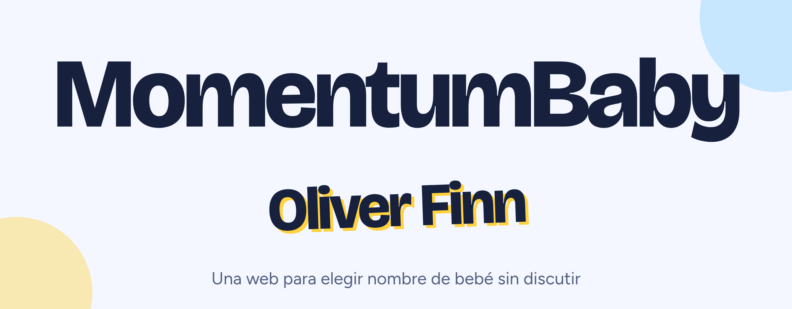
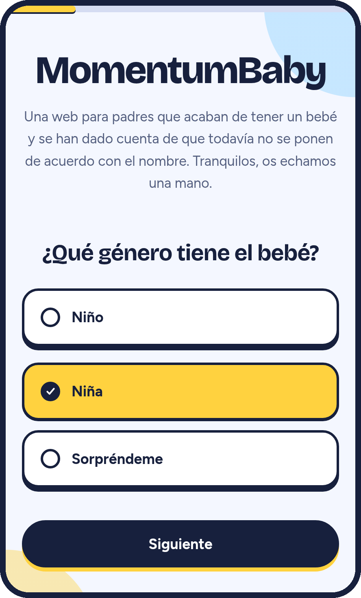
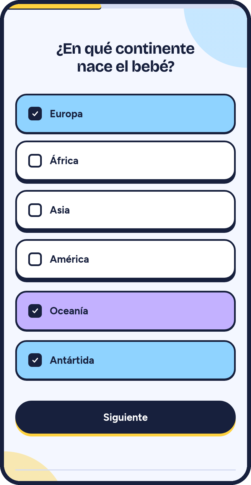
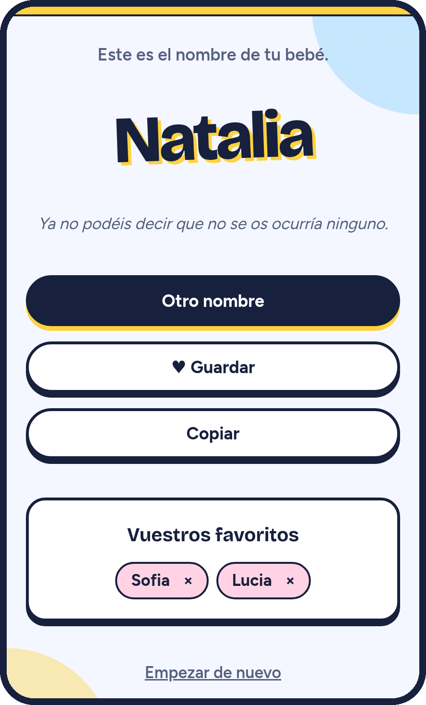
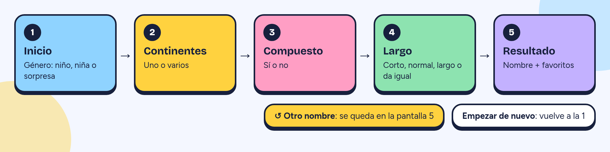
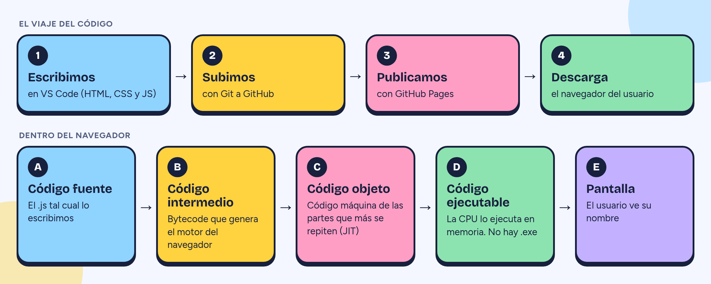
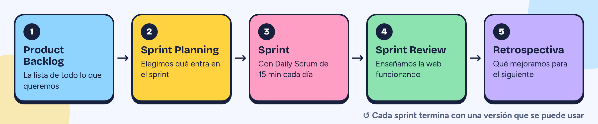

# MomentumBaby



Una web para padres que acaban de tener un bebé y todavía no se ponen de acuerdo con el nombre. Respondes cuatro preguntas y te propone uno.

**Pruébala:** https://wellm3id08.github.io/MomentumBaby/

Es nuestro trabajo en grupo de DAW 1 (diseño de una aplicación y planificación de su desarrollo). El documento y la presentación están en [`docs`](docs): [documento (PDF)](docs/MomentumBaby_Documento.pdf) y [presentación (PDF)](docs/MomentumBaby_Presentacion.pdf). Los editables (`.docx` y `.pptx`) están en la misma carpeta.

## Qué hace

Pregunta el género, el continente, si el nombre es compuesto y cuánto de largo. Devuelve un nombre al azar, y si no gusta se pide otro. Se puede guardar como favorito, copiar y cambiar de idioma (español, inglés y portugués).

| Inicio | Opciones | Resultado |
|---|---|---|
|  |  |  |



## Requisitos funcionales

RF1 elegir género · RF2 elegir continentes · RF3 nombre simple o compuesto · RF4 elegir el largo · RF5 ver un nombre y pedir otro · RF6 guardar favoritos · RF7 copiar el nombre · RF8 cambiar de idioma. Son los ocho que ya funcionan.
Ideas para la versión 2: RF9 votar en pareja y RF10 compartir favoritos con un enlace.

## Cómo está hecha

- **Lenguaje:** JavaScript, con HTML y CSS. Corre en el navegador, sin instalar nada.
- **Recursos:** muy pocos. Son menos de 100 KB y no hay base de datos; el idioma y los favoritos se guardan en el navegador.
- **Herramientas:** Visual Studio Code, Git y GitHub (con Pages), el navegador (Brave) para probar y Canva para los bocetos.
- **Desarrollo:** cinco fases (análisis, diseño, codificación, pruebas y mantenimiento) con un modelo iterativo incremental. Se hace un trozo que funcione, se enseña y se pasa al siguiente.



## Cómo nos organizamos

Usamos Scrum. Product Owner: [wellm3id08](https://github.com/wellm3id08). Scrum Master: [fdsfsfdfsfsfds](https://github.com/fdsfsfdfsfsfds). Equipo de desarrollo: [nicolasalvarezcallejon](https://github.com/nicolasalvarezcallejon) y [polmarc920](https://github.com/polmarc920).

- **Sprint 1 (4 días):** preguntas con nombre al azar, diseño y publicar la web.
- **Sprint 2 (3 días):** largo del nombre, otro nombre y copiar, idiomas y favoritos.
- **Sprint 3 (2 semanas, pendiente):** votar en pareja, compartir y significado de los nombres.

Cuatro reuniones: Sprint Planning al empezar cada sprint, Daily Scrum de 15 minutos cada día, Sprint Review al acabar y Retrospectiva después.



El backlog completo de 10 tareas está en el documento.

## Quién ha hecho qué

| Usuario de GitHub | Parte |
|---|---|
| [wellm3id08](https://github.com/wellm3id08) | Conceptos, bocetos, listas de nombres, GitHub Pages, idiomas y documentación |
| [fdsfsfdfsfsfds](https://github.com/fdsfsfdfsfsfds) | JavaScript y parte del HTML |
| [nicolasalvarezcallejon](https://github.com/nicolasalvarezcallejon) | HTML y parte del JavaScript |
| [polmarc920](https://github.com/polmarc920) | CSS |

## Ejecutarla en local

Abre `index/index.html` en el navegador, o desde esta carpeta:

```bash
python3 -m http.server 8000
```

y entra en http://localhost:8000/index/index.html.

## Carpetas

```
index/    las cinco páginas y la hoja de estilos
JS/       lógica, listas de nombres y textos en tres idiomas
Assets/   bocetos y lista original de nombres
docs/     documento y presentación
```
